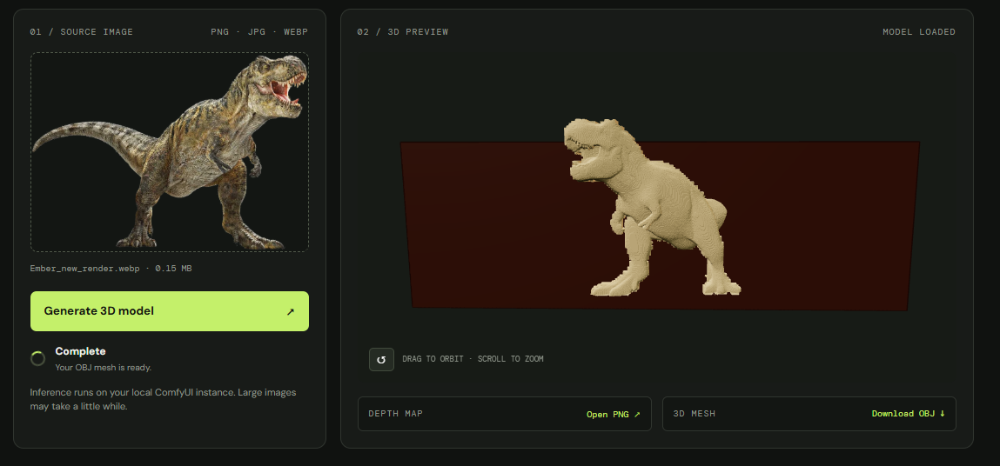
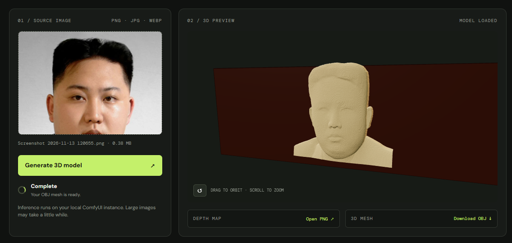
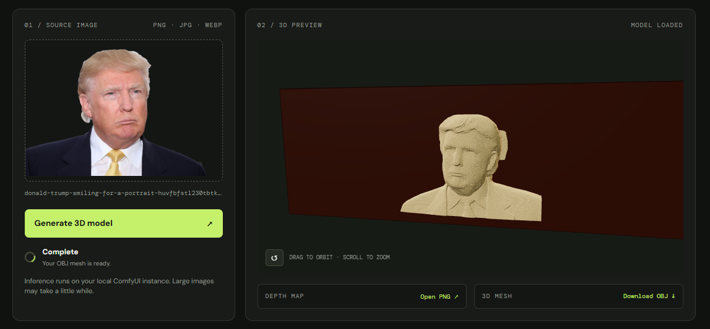
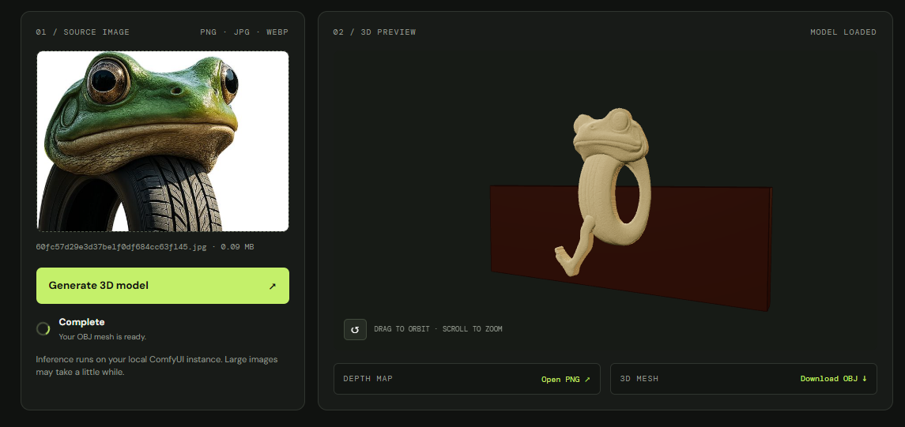

# MoGe-3 Web Studio

A small local web app:
1. Upload a selfie/photo in the browser.
2. FastAPI uploads it to ComfyUI.
3. ComfyUI runs your MoGe-3 API workflow and saves its depth PNG.
4. Your existing Python depth-to-OBJ script converts the PNG.
5. Three.js previews the OBJ in the browser; user can orbit/zoom and download it.

## Screenshots

### T-rex


### Kim Jong-Un


### Trump


### Boneca Ambalabu


## Setup

Python 3.10+ recommended.

```bash
python -m venv .venv
# Windows:
.venv\Scripts\activate
# Linux/macOS:
source .venv/bin/activate

pip install -r requirements.txt
```

Copy your existing depth-map converter into this directory as `depth_to_obj.py`.
It must accept two positional arguments:

```bash
python depth_to_obj.py INPUT_DEPTH.png OUTPUT.obj
```

If your converter uses another CLI, adapt `convert_depth()` in `main.py`.

## Configure ComfyUI

1. Start ComfyUI with its server enabled (default port 8188).
2. Open your MoGe-3 workflow.
3. Make sure its depth output is connected to a `Save Image` node.
4. Choose **Save (API Format)** and save the file as `workflows/moge3_api.json`.
5. Open the JSON and find the `LoadImage` node ID.
6. Set `COMFY_LOAD_IMAGE_NODE` to that ID. Default is `10`.

Configuration can be set as environment variables, or copied from `.env.example`
into your shell environment. `COMFY_URL` defaults to `http://127.0.0.1:8188`.

## Run

```bash
uvicorn main:app --host 127.0.0.1 --port 8000 --reload
```

Open http://127.0.0.1:8000

## API

- `GET /api/health`
- `POST /api/generate` — multipart form field `image`
- `GET /api/files/{id}/depth`
- `GET /api/files/{id}/model`
- `GET /api/files/{id}/download`

## Notes / limitations

- This starter expects the ComfyUI workflow to save the depth PNG as an image output.
  If the workflow saves a custom data type or writes elsewhere, adjust output extraction.
- The first saved image with "depth" in its filename is preferred; otherwise the first
  saved image is used.
- This is a synchronous prototype endpoint: the HTTP request stays open while ComfyUI
  runs. For production, switch to background jobs + a status endpoint / WebSocket.
- Three.js and its modules are loaded from jsDelivr, so the browser needs internet
  access for the preview. For fully offline use, vendor Three.js locally.
- Add authentication, upload limits, rate limiting, cleanup, and privacy controls
  before exposing this app to the public internet.
